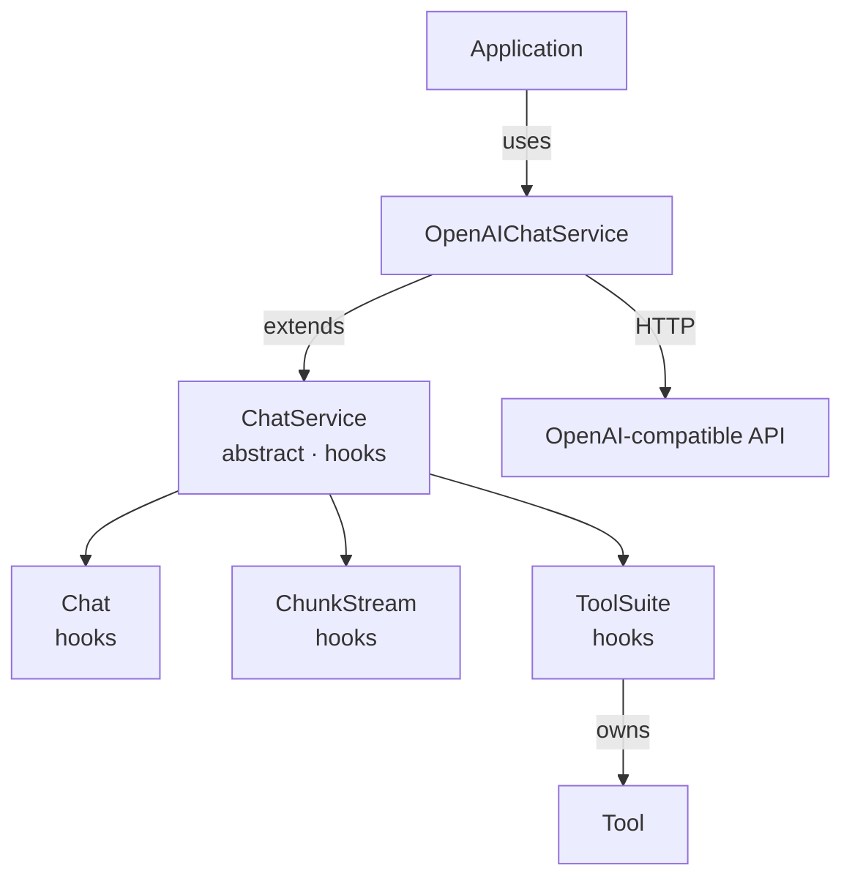

# Architecture

## Overview

The library is built around **Chats**, **Services**, **Tools**, and **Hooks**.

- **Chat / ChatInterface** - the public handle for building message histories and subscribing to chat events. Created by `service.chat()`.
- **ChunkStream / ChunkStreamInterface** - accumulates raw streaming chunks (content, reasoning, tool-call deltas, usage, finish) during `send()`. Accessed via `service.stream()`.
- **ChatService** - abstract base class that manages the tool-call loop. It owns the `Chat`, `ChunkStream`, and tool registry. Call `service.send()` to start the request/response cycle.
- **Tool** - abstract base class that custom tools extend.
- **ToolSuiteInterface** - exposed via `service.tools()`, lets callers add tools and attach hooks via `.hook().before/after/error().do()`.
- **Hooks** - five kinds: stream hooks (`service.stream().hook().chunks().do()`) for raw chunk observation, chat hooks (`chat.hook().message().do()`) for completed message observation, tool hooks (`service.tools().hook().before/after/error().do()`) for tool lifecycle events, service hooks (`service.hook().beforeSend/afterSend().do()`) for the send loop, and JSON hooks, declarative hooks defined in `.json` files that are auto-loaded on init/send.

Providers (like `OpenAIChatService`) extend `ChatService` and implement `createStream()` to connect to a specific API. Use `OpenAIChatService.builder()` for the common OpenAI-compatible setup, or construct the service directly with a preconfigured client.

Providers may also send request features such as `response_format`. The service
keeps parsing and validation separate: it stores the raw answer, exposes it via
`lastAssistantContent()` / `lastAssistantJson()`, and leaves schema validation,
refusals, business rules and retries to the caller.
