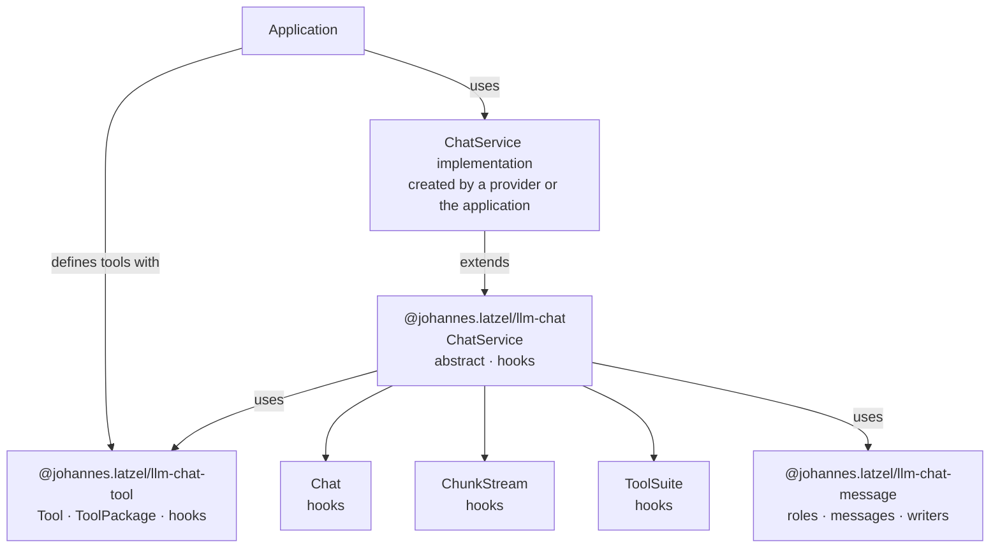

# Architecture

## Overview

The library is built around **Chats**, **Services**, **Tools**, and **Hooks**.
This package is the abstract engine. It depends on the message vocabulary in
`@johannes.latzel/llm-chat-message` and the tool primitives in
`@johannes.latzel/llm-chat-tool`, and ships no provider.

A provider is a `ChatService` subclass that implements `createStream()`.
The engine calls it once per provider round and turns the yielded
`StreamEvent` values into chat history, tool-call rounds, and stream chunks.



- **Chat / ChatInterface**: the public handle for building message histories and subscribing to chat events. Created by `service.chat()`.
- **ChunkStream / ChunkStreamInterface**: accumulates raw streaming chunks (content, reasoning, tool-call deltas, usage, finish) during `send()`. Accessed via `service.stream()`.
- **ChatService**: abstract base class that manages the tool-call loop. It owns the `Chat`, `ChunkStream`, and tool registry. Call `service.send()` to start the request/response cycle.
- **Tool**: abstract base class that custom tools extend; it lives in `@johannes.latzel/llm-chat-tool`, together with `ToolPackage`, `ToolParameters`, results and tool hooks.
- **Message vocabulary**: `ChatRole`, `ChatMessageOrigin`, `ChatMessage`, `ToolCall`, `ChatMatch`, `FinishReason` and the writer interfaces live in `@johannes.latzel/llm-chat-message`.
- **ToolSuiteInterface**: exposed via `service.tools()`, lets callers add tools and attach hooks via `.hook().before/after/error().do()`.
- **Hooks**: five kinds: stream hooks (`service.stream().hook().chunks().do()`) for raw chunk observation, chat hooks (`chat.hook().message().do()`) for completed message observation, tool hooks (`service.tools().hook().before/after/error().do()`) for tool lifecycle events, service hooks (`service.hook().beforeSend/afterSend().do()`) for the send loop, and JSON hooks, declarative hooks defined in `.json` files that are auto-loaded on init/send.

## Provider boundary

A provider subclasses `ChatService` and implements:

```typescript
protected abstract createStream(signal?: AbortSignal): AsyncIterable<StreamEvent>;
```

It maps the provider's request and response format to normalized
`StreamEvent` values: content, reasoning, refusal, tool-call deltas, usage and
finish. The base class owns the rest of the lifecycle.

See [Adding a new provider](services/custom-provider.md) for a skeleton
implementation.

## Tool definitions

Tools describe themselves with a neutral `ToolDefinition`:

```typescript
type ToolDefinition = {
    name: string;
    description: string;
    parameters: Record<string, unknown>;
};
```

`ToolSuite.getDefinitions()` returns the definitions of every registered tool.
Each provider converts them to its own request shape. The engine does not
contain a vendor serializer.

## Structured output

Providers may send request features such as `response_format`. The service
keeps parsing and validation separate: it stores the raw answer, exposes it via
`lastAssistantContent()` / `lastAssistantJson()`, and leaves schema validation,
refusals, business rules and retries to the caller.

- This page: engine and provider boundary.
- [Building messages](chats/building-messages.md): message flow and the system prompt tree.
- [Chat hooks](chats/chat-hooks.md), [JSON hooks](hooks/json-hooks.md),
  [service hooks](services/chat-service.md), and [tool hooks](https://johanneslatzel.github.io/llm-chat-tool/tools/tool-hooks/):
  hook and send-loop flows.
