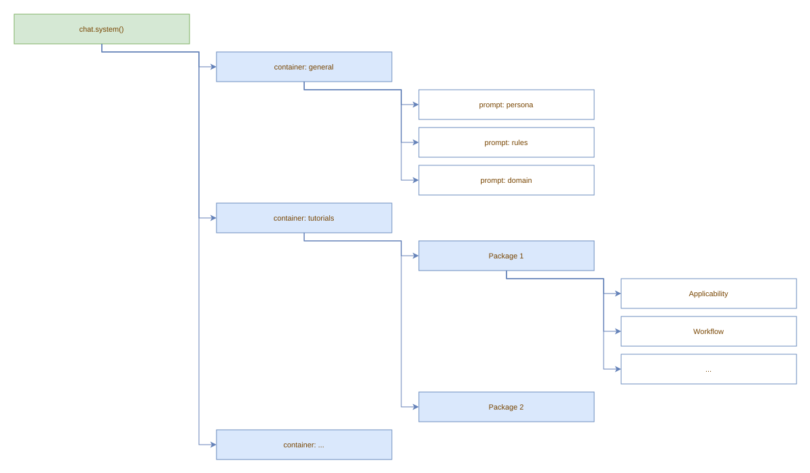
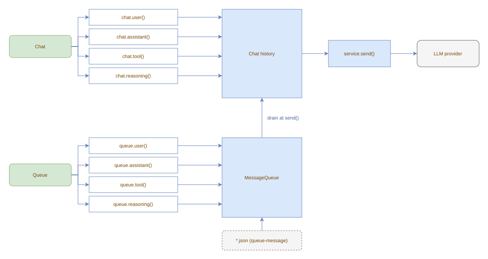

# Building messages

`ChatInterface` serves three purposes:

1. **Prepare**: build the message history the agent will see (system prompt, user messages, seeded assistant/tool messages)
2. **Record**: after `service.send()`, read back what the agent produced via `chat.messages()`
3. **React**: observe the stream in real time via hooks

## System prompt

The system prompt is built from a tree of components via `chat.system()`, which
returns the root `PromptContainer`. To bypass the tree entirely and send a
single flat string, set `ChatServiceConfiguration.systemPrompt`; `chat.getSystem()`
then returns that string while `chat.system()` still exposes the tree. See
[Flat system prompt](../services/openai.md#flat-system-prompt).



Two standard child containers are available for organisation:

- **`chat.system().child('general')`**: for persona, rules, domain, behavior, and other general system prompt components
- **`chat.system().child('tutorials')`**: populated automatically by `ToolSuite` when tool packages with tutorial content are registered

General prompt files can be loaded automatically from a directory via
`ChatServiceConfiguration.systemPromptDir` (env: `LLM_CHAT_SYSTEM_PROMPT_DIR`).
All `.md` and `.txt` files in the directory are loaded as components under
`general`, with the filename (without extension) as the prompt ID.
Files with any other extension are ignored. The directory is read only if it
exists; it is never created and no default files are written.

The system prompt is stored separately from the regular message list:

- **`chat.messages()`**: returns only user, assistant, tool, and reasoning messages. The system message is **not** included.
- **`chat.getSystem()`**: returns the effective system message: an override installed by the service (a flat `systemPrompt`) when configured, otherwise the composed prompt tree. `null` when neither yields content.

When `service.send()` sends messages to the provider, the system prompt is always the first element.

Every message is automatically timestamped with a `createdAt: Date` set at creation time and tagged with an `origin` field (`ChatMessageOrigin`) indicating whether it came from the user, the model, a tool, a hook, or the system prompt.

## Tutorial container

The `tutorials` child container is populated automatically by `ToolSuite`.
When a `ToolPackage` with a non-null `tutorial()` return value is registered,
the suite creates a sub-container titled `Tool Package <ClassName>` with an
`Applicability` child (the comma-separated tool names) and a `Tutorial` child
(the value returned by `tutorial()`). The resulting tree is injected under
`chat.system().child('tutorials')`, so it appears in every conversation
alongside the general prompts. See [Tool packages](../tools/packages.md#tutorial)
for the full example.

## Adding messages

```typescript
chat.system().child('general').prompt('persona').setContent("You are a pirate.");
chat.user("Hello!");

// seed assistant responses or fake tool calls
chat.assistant("Let me check...", [{ id: "call_1", type: "function", function: { name: "get_weather", arguments: '{"city":"Berlin"}' } }]);
chat.tool('{"temp":22}', "call_1");
chat.assistant("It's 22°C.");
```

## Direct chat vs message queue

Messages can be added in four ways: `user()`, `assistant()`, `tool()`, and `reasoning()`, either directly on the chat handle or via the message queue. Choose based on timing and concurrency needs.



### Direct chat (`chat.xxx()`)

Use `chat.user()`, `chat.assistant()`, `chat.tool()` to:

- **Build history before sending**: prepare the conversation that will be sent to the LLM on the next `service.send()`.
- **Record model output**: after `service.send()` returns, the service uses direct chat internally to record assistant responses and tool results.
- **Fire message hooks immediately**: appending triggers any registered message hooks in real time.

Messages are appended immediately under the chat's own mutex.

### Message queue (`service.queue().xxx()`)

Use `service.queue().user()`, `service.queue().tool()` to:

- **Enqueue from concurrent contexts**: timers, interrupt handlers, or any code that runs while an in-flight `send()` is executing. The queue has its own mutex and does not block the send.
- **Stage messages without triggering hooks**: queued messages sit in a buffer. No hooks fire during enqueue.
- **Inject from JSON hooks**: hook definitions with the `queue-message` action write to the same queue, tagged with `origin: Hook`.

Messages are drained into the chat at the start of the next `service.send()` call. At that point they fire message hooks like any other added message. See [ChatService message queue](../services/chat-service.md#message-queue) for details.

### Hook-specific variant

Hooks use a separate `HookMessageWriter` interface (backed by the same `MessageQueue`) to enqueue messages with an explicit `origin` parameter. See [HookMessageWriter](../hooks/hook-message-writer.md).

### Quick reference

| Use this | When to use |
|----------|-------------|
| `chat.user()` / `chat.assistant()` / `chat.tool()` | Immediate appending, hook firing, building history before `send()` |
| `service.queue().user()` / `service.queue().tool()` | Concurrent staging, deferred processing, hook injection |

## Clearing

`chat.clear()` removes all conversation messages, clears historic messages,
clears the system prompt tree (children are removed, title is reset), and
unregisters any message hook listeners. The same `PromptContainer` root stays
in place; children are cleared rather than replaced:

```typescript
chat.system().child('general').prompt('persona').setContent("You are a pirate.");
chat.user("Hello!");
chat.clear();
chat.messages(); // []
chat.getSystem(); // null
```

Pass `retainHooks: true` to preserve message hooks across the reset:

```typescript
const hook = chat.hook().message(ChatRole.User).do(cb);
chat.clear(true);   // hook survives
```

If tool packages with tutorials were registered, call `service.resetTutorials()`
after `chat.clear()` to re-attach and re-populate the `tutorials` child container
in the fresh system prompt tree. See [ChatService](../services/chat-service.md).

### Clearing messages only

`chat.clearMessages()` removes conversation and historic messages, keeping the
system prompt and message hook listeners intact:

```typescript
chat.system().add(new Prompt('Persona', 'You are a pirate.'));
await chat.user("Hello!");
await chat.handoff({ apply: () => [] }); // populates historic messages
chat.clearMessages();
chat.messages();          // []
chat.historicMessages();  // []
chat.getSystem();         // not null (system prompt preserved)
```

### Silent mode

`chat.silent(true)` suppresses emission of new messages to hook listeners
without affecting the message history. Call `chat.silent(false)` to re-enable:

```typescript
chat.silent(true);
await chat.user("This won't trigger hooks"); // hooks do not fire
chat.silent(false);
await chat.user("This will trigger hooks");  // hooks fire normally
```

Messages are still added to history while silent.

To reset the entire service (chat, stream, tools, and JSON hooks) in one call,
use `service.clear()`; see [ChatService](../services/chat-service.md).
