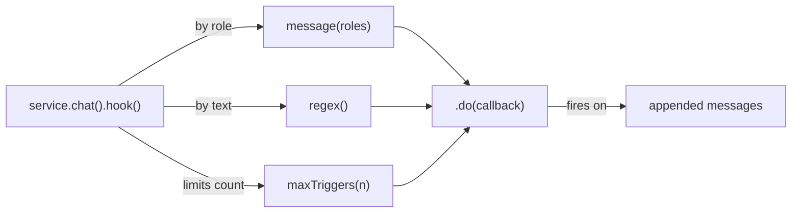

# Chat hooks

All observation is done through hooks returned by `chat.hook()`.



## Message hooks

Subscribe to messages matching a role and/or regex:

```typescript
import { ChatRole } from "@johannes.latzel/llm-chat-message";

chat.hook()
    .message(ChatRole.User)              // optional: filter by role(s)
    .regex(/hello/i)                     // optional: filter by regex
    .maxTriggers(3)                      // default: Infinity
    .do((message, matches) => {
        console.log(message.content);
        console.log(matches[0]);    // full match
    });
```

| roles | regex | Behavior |
|-------|-------|----------|
| unset | unset | Nothing matches |
| set | unset | Matches any message with that role |
| unset | set | Matches any message matching the regex |
| set | set | Matches only if role AND regex match |

`message()` accepts multiple roles: `.message(ChatRole.User, ChatRole.Assistant)`.

## Disposal

```typescript
const hook = chat.hook().message(ChatRole.User).do(cb);
hook.dispose();  // safe to call multiple times
```

## Clearing

`chat.clear()` unregisters all message hooks. Hook objects that were returned
by `.do()` become orphans; calling `.dispose()` on them after `clear()` is a
harmless no-op. Pass `retainHooks: true` to preserve hooks across the reset:

```typescript
chat.clear();        // hooks unregistered
chat.clear(true);    // hooks preserved
```

## Notes

- Hooks are **not serialized**; re-register after `chatFromJSON()`
- Async handlers in `do()` are awaited before the next message is processed
- `MessageHookBuilder` defaults `maxTriggers` to `Infinity`

## Example pages

- [Hooks](../examples/hooks.md)
