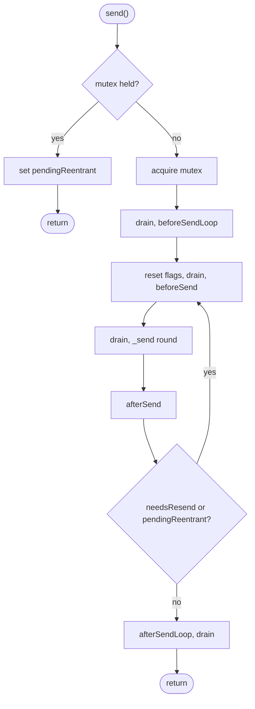
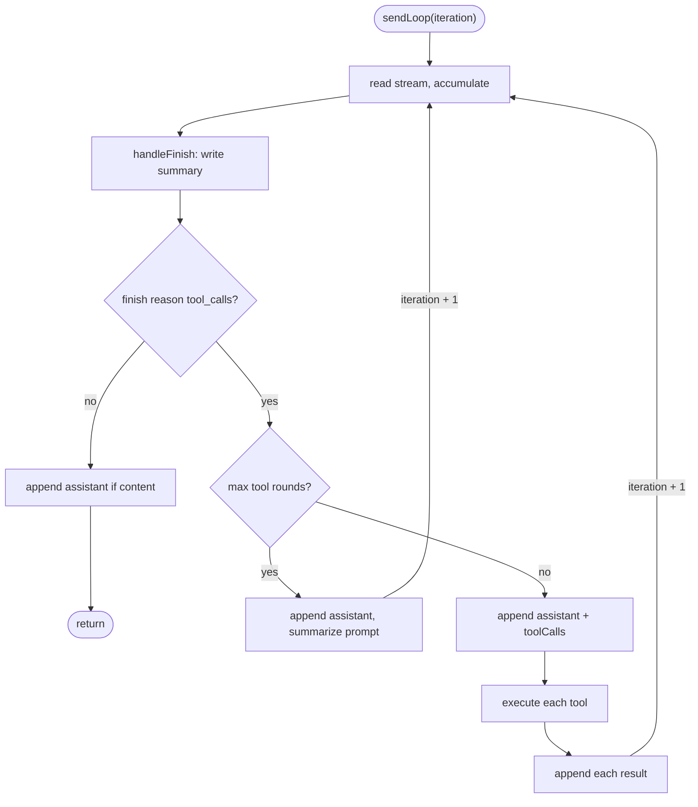
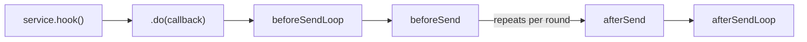

# ChatService

`ChatService` handles the tool-call loop. It owns the chat instance and tool registry. Tools are registered via `service.tools().add(...)`:

```typescript
import { ChatServiceConfiguration, OpenAIChatService } from "@johannes.latzel/llm-chat";

const config = new ChatServiceConfiguration();
config.maxToolCallRounds = 25;
config.systemPromptDir = "./prompts";
config.userPromptPaths = ["./context.md"];

const service = OpenAIChatService.builder()
    .model("your-model")
    .withServiceConfig(config)
    .create();

const chat = service.chat();
// ... setup messages ...
await service.send();
```

The base class accumulates stream events, assembles tool calls, recurses on tool responses, and errors safely.



## Configuration

| Property | Env var | Default | Description |
|----------|---------|---------|-------------|
| `maxToolCallRounds` | `LLM_CHAT_MAX_TOOL_CALL_ROUNDS` | `10` | Max tool-call recursion depth |
| `systemPromptDir` | `LLM_CHAT_SYSTEM_PROMPT_DIR` | `./prompts/` | Directory of `.md`/`.txt` system prompt files (read if it exists; never created) |
| `userPromptPaths` | `LLM_CHAT_USER_PROMPTS` | `""` | Comma-separated file paths for initial user messages |
| `hooksDir` | `LLM_CHAT_HOOKS_DIR` | unset | Directory containing `.json` hook definition files |
| `systemPrompt` | `LLM_CHAT_SYSTEM_PROMPT` | unset | Flat string that overrides the system prompt tree entirely; file-based system prompts are skipped |
| `systemPromptFile` | `LLM_CHAT_SYSTEM_PROMPT_FILE` | unset | Single file loaded as the flat system prompt; `systemPrompt` takes precedence |
| `trimMessages` | — | `false` | Trim leading/trailing whitespace from assistant and reasoning content before storing |
| `parseInlineReasoning` | `LLM_CHAT_PARSE_INLINE_REASONING` | `false` | Parse explicit inline reasoning markers in streamed content |
| `inlineReasoningMarkers` | — | `<think>` / `</think>` | Marker pair used when `parseInlineReasoning` is enabled |
| `parseInlineToolCalls` | `LLM_CHAT_PARSE_INLINE_TOOL_CALLS` | `false` | Parse explicit inline tool-call blocks in streamed content |
| `inlineToolCallMarkers` | — | `<tool_call>` / `</tool_call>` | Marker pair used when `parseInlineToolCalls` is enabled |
| `contextWindowSizeHint` | `LLM_CHAT_CONTEXT_WINDOW_SIZE_HINT` | `0` | Context window hint in tokens (`0` = unlimited). Used by `isContextWindowExceeded()`: the service does **not** enforce it automatically |

Inline parsing is provider-independent and disabled by default. See
[Inline reasoning](inline-reasoning.md) for reasoning marker semantics,
cancellation and error behavior. See [Inline tool calls](inline-tool-calls.md)
for payload shapes, execution and the finish-reason override.

## Eager initialisation

By default, prompt files from `systemPromptDir` or a configured
`systemPromptFile` are loaded lazily on the first `send()`. Call `init()` to
load them upfront, allowing inspection or display of the full system prompt
(e.g. a `/system` command). `systemPrompt` takes precedence over
`systemPromptFile`, which takes precedence over `systemPromptDir`. When a flat
`systemPrompt` is set, both file-based system prompts are skipped; user prompt
files and JSON hooks still load.

```typescript
await service.init();
const system = service.chat().getSystem();
// system.content now includes all file-based prompts under general
```

`init()` is idempotent and safe to call concurrently; subsequent calls are
no-ops until the next `service.clear()` call. `estimateTokens()` calls
`init()` when needed, so file-based system prompts and user prompt files are
included in the estimate even before the first `send()`.

To reload prompt files only (e.g. after modifying files on disk
at runtime), call `loadPromptFiles()` directly. Unlike `init()`, it always
re-reads the directory and replaces the `general` container contents.

## Full reset

`service.clear()` resets the entire service to a clean state:

- Calls `JsonHookRegistry.clear()`: disposes all JSON-loaded hooks
- Calls `ChunkStream.clear()`: removes chunks, resets sequence, unregisters chunk listeners
- Calls `Chat.clear()`: removes messages, clears system prompt, unregisters message listeners
- Calls `ToolSuite.clear()`: removes tools and packages, unregisters tool event listeners
- Calls `resetTutorials()`: re-attaches the tutorial container to the fresh system prompt tree
- Resets the internal `_contextLoaded` flag so the next `send()` re-runs `init()` (re-loads prompt files and JSON hooks)

```typescript
service.clear();
await service.send(); // re-initialises from scratch
```

## Tutorial reset

When `chat.clear()` is called directly (not through `service.clear()`), tool
tutorials in the system prompt tree are cleared along with everything else. To
re-attach and re-populate them from the still-registered tool packages, call
`resetTutorials()`:

```typescript
chat.clear();
service.resetTutorials();
// chat.getSystem() now includes tutorials again
```

## Message queue

`service.queue()` returns a `MessageWriter` that stages messages for the next `send()` call without blocking the send mutex. This is useful for enqueueing messages from a concurrent context (timer, interrupt handler, etc.) without waiting for an in-flight request to finish.

```typescript
await service.queue().user('Timer "build" (30s) has expired.');
await service.send(); // drains the queue into chat before sending
```

Messages enqueued via `service.queue()` are assigned an origin based on their role (`User` for user messages, `Tool` for tool messages, etc.).

Hooks enqueue messages through a separate `HookMessageWriter` interface. Hook-inserted messages are tagged with `origin: Hook` so they can be distinguished from user-provided or model-generated messages. See [JSON hooks](../hooks/json-hooks.md) for details.

The queue uses its own mutex, so enqueuing is fast and independent of the send and chat mutexes.

For guidance on choosing between direct chat and the queue, see [Building messages: Direct chat vs message queue](../chats/building-messages.md#direct-chat-vs-message-queue).

## Structured result access

After `send()`, read the final answer from either helper:

```typescript
const content = service.lastAssistantContent(); // string | undefined
const value = service.lastAssistantJson<MyType>(); // MyType | undefined
```

`lastAssistantContent()` returns the most recent assistant message content.
`lastAssistantJson()` parses the latest provider round as JSON. It returns
`undefined` when there is no content and throws `StructuredOutputError` when
the model refused, the response was filtered or incomplete, or the content is
not valid JSON.

The helper only parses JSON. It does not validate against a schema, repair the
answer, or retry. Use a validator such as Ajv or Zod in the caller when the
schema is not enough for your business rules.


## Tool-call loop

Each provider round is streamed by `sendLoop(iteration)`, with `iteration` starting at `0`. When the model returns tool calls, every tool runs and its results are appended as `tool` messages before the next round, which is a recursive `sendLoop(iteration + 1)` call. Rounds continue until the model stops calling tools, or until `maxToolCallRounds` is reached and the model is asked to summarise its progress.



## Tool injection

`service.injectToolCall(toolName, args)` executes a registered tool and queues the result as if the model had called it, without firing tool hooks or waiting for an LLM round-trip.

```typescript
await service.injectToolCall("fetch_weather", { city: "Berlin" });
await service.send(); // drains the queue at the start of send()
```

The tool runs silently (no tool events are emitted), then an assistant message with a synthetic tool call and one or more tool result messages are enqueued into the message queue. `injectToolCall` does **not** call `interrupt()` or `send()`; the caller decides when to flush.

Throws if no tool named `toolName` is registered.

## Context window estimation

The service provides two methods to estimate whether the conversation is
approaching the model's context window limit. This is useful for proactive
tokens management (trimming history, summarizing, or warning the user)
before calling `send()`.

```typescript
const tokens = await service.estimateTokens();
const exceeded = await service.isContextWindowExceeded();
```

### What is counted

`estimateTokens()` estimates the total tokens for the full context that would
be sent to the LLM on the next `send()`:

1. **System prompt**: the effective system message: the flat `systemPrompt` when set, otherwise the composed prompt tree
2. **Chat messages**: the stored messages the provider will send (see [Provider message filtering](#provider-message-filtering)), including any content transformation, `tool_calls` and `tool_call_id` payload sent with a message
3. **Queued messages**: messages staged via `service.queue()` that have not yet been drained, filtered the same way
4. **Tool definitions**: all registered tools serialized to their wire format
5. **Provider request features**: provider-specific input such as a serialized
   `response_format`, via `estimateRequestTokens()`

The output reserve from `estimateCompletionTokens()` is **not** included here.
It is applied only by `isContextWindowExceeded()` as a proactive guard, and it
is a **very loose upper bound**: the provider's configured maximum output, not
an estimate of the actual response.

### Provider message filtering

Providers drop some stored messages from their requests. `ChatService.shouldSendMessage()`
is a protected predicate with a `true` default; provider subclasses override it to
exclude messages they do not send. `estimateTokens()` applies the predicate to both
stored and queued messages, so the estimate stays consistent with `createStream()`.

`OpenAIChatService` drops `ChatRole.Reasoning` messages when `filterReasoning` is
true (the default), so stored reasoning does not count towards the estimate. When
`filterReasoning` is false, reasoning is sent and is counted.

### Strategy pattern

Both methods accept an optional `TokenEstimator` strategy to customize how
text is converted to token estimates:

```typescript
export interface TokenEstimator {
    estimate(text: string): number;
}
```

The default implementation is `CharCountEstimator` (`chars / 4`), which
provides a rough approximation suitable for many models. Pass a custom
estimator for model-specific tokenization:

```typescript
import { CharCountEstimator } from '@johannes.latzel/llm-chat';

// use a different chars-per-token ratio
const est = new CharCountEstimator(3);
await service.estimateTokens(est);
await service.isContextWindowExceeded(est);

// or implement the interface for a proper tokenizer
class TiktokenEstimator implements TokenEstimator {
    estimate(text: string): number {
        return encoding.encode(text).length;
    }
}
await service.estimateTokens(new TiktokenEstimator());
```

### Threshold

Configure `contextWindowSizeHint` on `ChatServiceConfiguration` (default `0` =
unlimited). `isContextWindowExceeded()` returns `false` when the limit is
`0`. When set to a positive number, it returns `true` if `estimateTokens()`
plus the provider's completion reserve exceeds the configured value.

The reserve exists **only** for this proactive check. The context window is
shared by the prompt and the response, so without it a prompt that fits on its
own could still leave no room for the next answer. `estimateCompletionTokens()`
defaults to `0` and is deliberately not part of `estimateTokens()`.
`OpenAIChatService` overrides it with `maxCompletionTokens`, falling back to
`maxTokens`. Treat it as a **very loose upper bound**: it is the configured
maximum completion budget, not a prediction of the actual answer. A high cap
makes the check conservative and can trigger handoff earlier than necessary.
The comparison is strict: a value exactly at the hint is not exceeded.

```typescript
const config = new ChatServiceConfiguration();
config.contextWindowSizeHint = 128_000; // 128k tokens

const service = OpenAIChatService.builder()
    .model("your-model")
    .withServiceConfig(config)
    .create();

// later, before send():
if (await service.isContextWindowExceeded()) {
    // trim or summarize
}
```

## Context window handoff

When the estimated token count exceeds the context window, use `chat.handoff()`
to compact the conversation history. The method uses a strategy pattern: provide
a `HandoffStrategy` that returns a compacted message list to replace the current
history.

```typescript
export interface HandoffStrategy {
    apply(chat: ChatInterface): ChatMessage[];
}
```

The strategy receives the current chat and must return an array of non-system
messages. Typical strategies include summarising old messages into a single
synthetic user message or dropping the oldest messages.

```typescript
// Drop oldest messages, keeping only the last 5
const strategy: HandoffStrategy = {
    apply(chat) {
        const msgs = chat.messages();
        return msgs.slice(-5).map(m => ({
            ...m,
            content: `[compacted] ${m.content}`
        }));
    }
};

await chat.handoff(strategy);
```

### How handoff works

1. The strategy is applied to produce a compacted message list
2. Current messages are appended to `chat.historicMessages()` (read-only snapshot)
3. The chat is silenced, all messages are cleared, compacted messages are inserted
4. Emission is re-enabled; hooks do not fire during the swap

### Historic messages

Archived messages accumulate on `chat.historicMessages()`:

```typescript
const archive = chat.historicMessages();
// readonly ChatMessage[]
```

### Example: summarising handoff

```typescript
import { ChatRole } from '@johannes.latzel/llm-chat';

// After detecting isContextWindowExceeded():
await chat.handoff({
    apply(chat) {
        const msgs = chat.messages();
        return [{
            role: ChatRole.User,
            content: `[Previous conversation summarised: ${msgs.length} messages archived]`,
            createdAt: new Date(),
            origin: 'system' as any
        }];
    }
});
```

## Streaming

Stream hooks are documented in [Stream hooks](stream-hooks.md).

## Service hooks

Service hooks fire around the LLM request lifecycle. They allow injecting
messages or controlling retry behavior from inside the send loop.



### Hook reference

| Hook | Callback | When it fires | Use case |
|---|---|---|---|
| `.beforeSendLoop()` | `() => void` | Before the do/while retry loop, after initial queue drain | Inject messages before any iteration |
| `.beforeSend()` | `() => void` | Each retry iteration, before `_send()`, after queue drain | Inject messages into the current LLM request |
| `.afterSend()` | `() => void` | Each retry iteration, after `_send()` | Check conditions and call `service.setNeedsResend()` to retry |
| `.afterSendLoop()` | `() => void` | After the do/while loop exits, before final queue drain | Inject messages after the loop finishes |

### Queue drain sequence

The service drains the message queue at four points during `send()`:

1. **Before `beforeSendLoop`**: picks up externally queued messages
2. **At the start of each iteration, before `beforeSend`**: picks up messages queued during the previous iteration
3. **After `beforeSend`**: picks up messages injected by the hook for the current iteration (they go into the immediately following `_send()`)
4. **After `afterSendLoop`**: cleanup before `send()` returns

### Reentrant safety

Calling `service.send()` from inside a service hook never deadlocks; the call
is detected as reentrant and the outer loop runs another iteration instead.

**Limitation:** reentrant `send()` from `afterSendLoop` is safe (no deadlock),
but the extra iteration is lost because the outer loop has already exited.
Use `afterSend` to trigger a retry from a hook.

### Async support

Service hooks support async callbacks. Even though the callback type is `() => void`,
TypeScript accepts async functions (a function returning `Promise<void>` is assignable
to `() => void`). Async callbacks are **awaited** before the send loop continues,
ensuring messages queued via `service.injectToolCall()` or `service.queue()` are in
the queue before `_drainQueue()` runs.

```typescript
service.hook()
    .beforeSend()
    .do(async () => {
        await service.injectToolCall("fetch_weather", { city: "Berlin" });
    });
```

The same applies to `beforeSendLoop`, `afterSend`, and `afterSendLoop`.

### Examples

```typescript
// inject a message before every request
const cleanup = service.hook()
    .beforeSend()
    .do(() => service.queue().user("Be concise"));

// retry after the first send if condition isn't met
service.hook()
    .afterSend()
    .do(() => {
        if (!ok) service.setNeedsResend();
    });

// later: cleanup.dispose();
```


## Example pages

- [Agent Loop](../examples/agent-loop.md)
- [Context Management](../examples/context-management.md)
- [Interruption](../examples/interruption.md)
- [Service Hooks](../examples/service-hooks.md)
- [Persistence](../examples/persistence.md)
