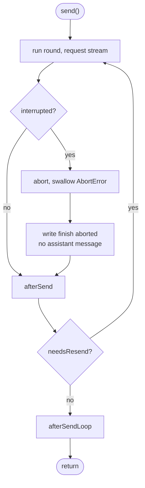

# Interrupt

Abort any in-flight LLM request. Optionally signal that a re-send is needed.

```typescript
// Fire-and-forget: abort without re-sending
service.interrupt();

// Abort and flag that a re-send is needed
service.interrupt(true);
```

## Re-sending

`interrupt(true)` sets a flag that makes the running `send()` loop again before it returns. The flag is reset once `send()` runs.

The flag only takes effect when it is set during a running `send()`, for example from a hook; setting it before `send()` starts does nothing. `setNeedsResend()` sets the same flag without aborting the stream, so it follows the same rule.

## How it works

`this._abortController?.abort()` fires immediately; the in-flight stream catches the `AbortError` and stops. No mutex is acquired during `interrupt()`.

When an abort occurs, a FinishChunk with `FinishReason.Aborted` is pushed to the stream so consumers can detect the interruption:

```typescript
service.stream().hook().chunks(ChunkType.Finish).do((chunk) => {
    if (chunk.finishReason === FinishReason.Aborted) {
        // handle interrupt
    }
});
```




## Example pages

- [Interruption](../examples/interruption.md)
