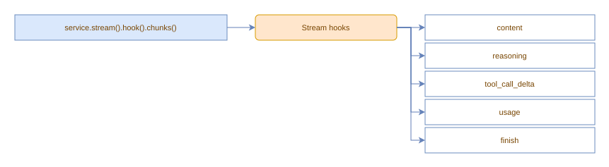

# Stream hooks

Stream hooks observe raw streaming output (content, reasoning, tool-call deltas, usage, finish). They are accessed through `service.stream().hook()`.



```typescript
// content chunks
service.stream().hook().chunks(ChunkType.Content).do((chunk) => {
    process.stdout.write(chunk.text);
});

// reasoning chunks
service.stream().hook().chunks(ChunkType.Reasoning).do((chunk) => {
    process.stdout.write(chunk.text);
});

// tool call delta chunks
service.stream().hook().chunks(ChunkType.ToolCallDelta).do((chunk) => {
    console.log(`Tool ${chunk.toolCallId}: ${chunk.text}`);
});

// usage chunk (emitted before the finish chunk when usage is requested)
service.stream().hook().chunks(ChunkType.Usage).do((chunk) => {
    console.log(`Tokens: ${chunk.usage.total_tokens}`);
});

// finish event
service.stream().hook().chunks(ChunkType.Finish).do((chunk) => {
    console.log(`\nFinished: ${chunk.finishReason}`);
});

// all chunk types
service.stream().hook().chunks().do((chunk) => {
    console.log(chunk.type, chunk.seq, chunk.batch);
});
```

`.chunks()` is always required in the chain. Pass one or more `ChunkType` values to filter, or no arguments to receive every chunk.

Each returns a `Hook`; call `.dispose()` to unsubscribe.

Stream hooks are **fire-and-forget**: async callbacks passed to `do()` are not awaited. Use them for observation and side effects (logging, display) that should not block the stream pipeline.

## Chunk identity

Every chunk has two numeric fields:

- **`seq`**: position within the current batch (`0`, `1`, `2`...). Resets to `0` on each `send()`.
- **`batch`**: which `send()` cycle the chunk belongs to (`1` for the first `send()`, `2` for the second, etc.). Incremented automatically when the stream is cleared.

Use `batch` to distinguish chunks from separate `send()` calls when accumulating them manually.

## Stream state

Access accumulated chunks and finish reason after `send()`:

```typescript
await service.send();
const allChunks = service.stream().chunks();
const reason = service.stream().finishReason();
```

The stream state (chunks, seq, batch) is automatically cleared at the start
of each `send()` call. Chunk listeners are preserved across sends; hooks
registered on the stream survive multiple `send()` rounds within the same
conversation. To fully remove stream hooks, call `service.stream().clear()` or
`service.clear()`.

## Summaries

Each provider round records a `StreamSummary` containing that round's aggregated
output. A `send()` that triggers tool calls produces one summary per round:

```typescript
service.stream().clearSummaries();
await service.send();

const summaries = service.stream().summary();
// Each entry:
//   .content: content text from that round
//   .reasoning: reasoning text from that round
//   .toolCallCount: number of tool calls invoked in that round
//   .finishReason: why the round finished
//   .usage: token usage, when the provider reports it
//   .timestamp: when the summary was created

const lastRound = summaries.at(-1);                                                      // most recent round
const totalTokens = summaries.reduce((sum, s) => sum + (s.usage?.total_tokens ?? 0), 0); // all rounds
```

Summaries accumulate across multiple `send()` calls. Call `service.stream().clearSummaries()` to reset them without affecting chunks or hooks.

Reasoning chunks can come from structured provider fields or from explicit
inline markers when `parseInlineReasoning` is enabled. Live chunks preserve the
order and boundaries of reasoning segments; `StreamSummary.reasoning`
concatenates them for the provider round. See
[Inline reasoning](inline-reasoning.md).

When `parseInlineToolCalls` is enabled, a complete `<tool_call>` block produces
a normal `ChunkType.ToolCallDelta` chunk and participates in the tool-call loop.
See [Inline tool calls](inline-tool-calls.md).

## Ordering guarantee

When the stream finishes, the `FinishChunk` is pushed to the stream (and stream hooks fire) **before** the completed message is appended to chat (and chat hooks fire). This means stream hooks see the finish before chat hooks see the resulting message.
