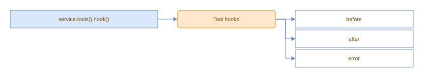

# Tool hooks

The tool suite exposes a `.hook()` method that returns a builder with `.before()`, `.after()`, and `.error()` methods.



Use `.filter(...names)` to restrict which tools fire the hook:

```typescript
const service = OpenAIChatService.builder()
    .model("your-model")
    .create();

// fires for ALL tools
service.tools().hook().before().do((name, args) => {
    console.log(`Running ${name}`);
    args.injected = "context";  // mutations affect the tool
});

// fires only for "greet"
service.tools().hook().filter("greet").after().do((result) => {
    console.log(`Done: ${result.result}`);
});

service.tools().hook().error().do((name, error) => console.error(`Failed: ${error.message}`));
```

Each returns a `Hook`; call `.dispose()` to unsubscribe. Async handlers in `do()` are awaited before tool execution proceeds (before-hooks) or before the next result is processed (after-hooks).

`after()` hooks fire only for successful results; failed tool calls fire `error()` hooks instead.

`service.tools().clear()` unregisters all tool event listeners alongside
removing registered tools. Pass `retainHooks: true` to preserve listeners.

Before-hooks receive the actual `args` object; mutations in-place propagate to the tool. After- and error-hooks are observers (mutations don't affect the returned result).
